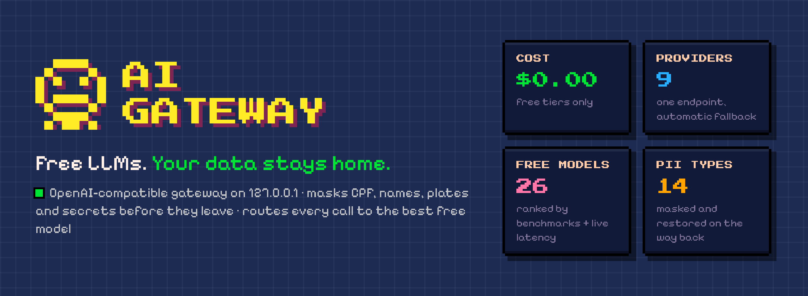
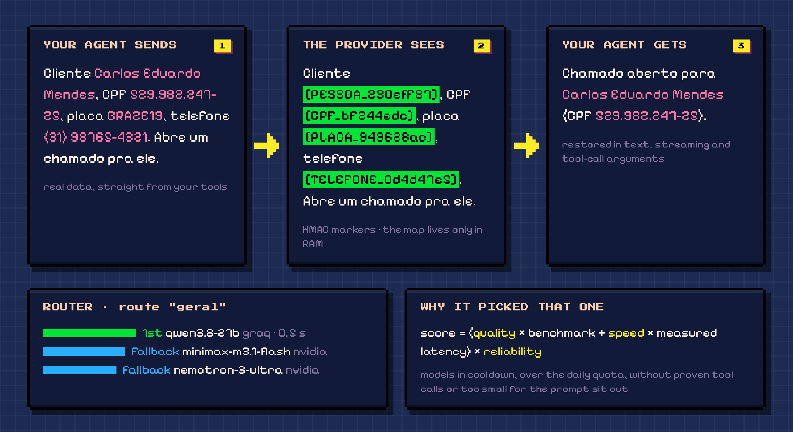
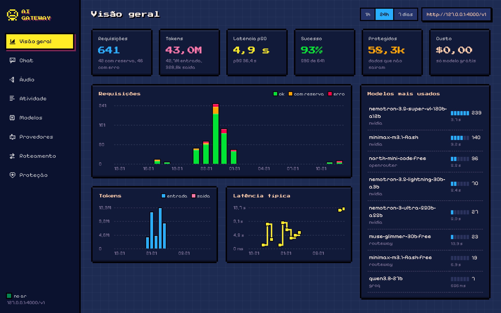
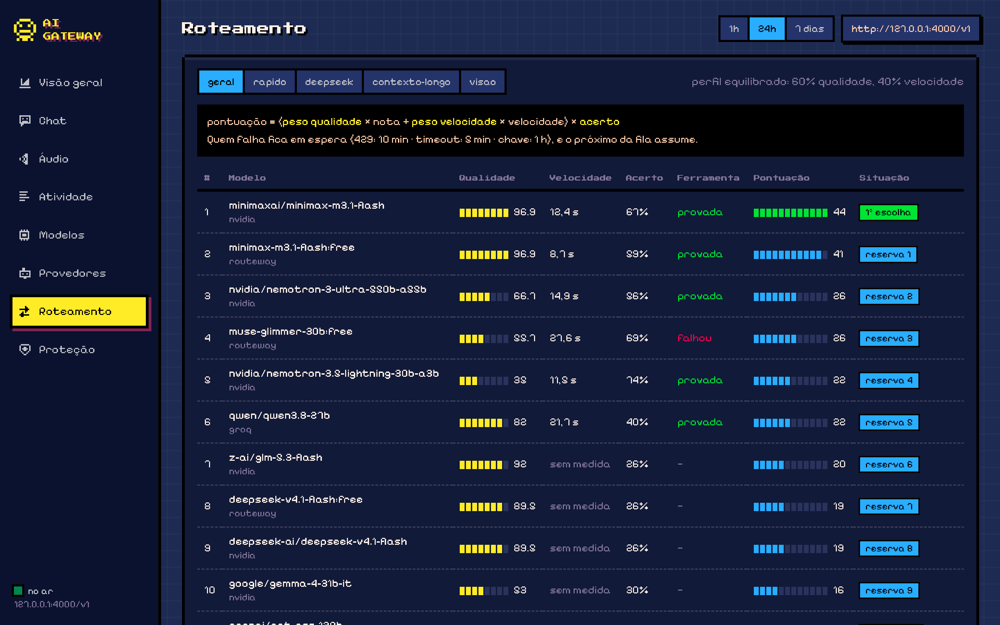
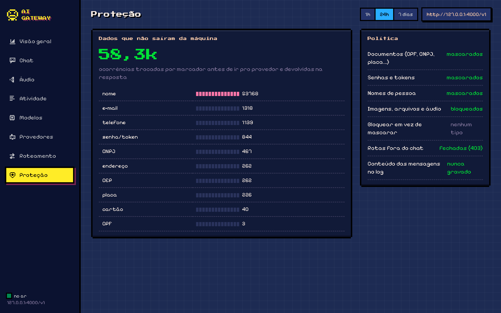

<p align="center"></p>

<p align="center">
  <a href="LICENSE"></a>
  
  
  
  
</p>

<p align="center">
  <b>English</b> · <a href="README.pt-BR.md">Português</a>
</p>

# ai-gateway

**Use free LLMs for real work without handing them your customers' data.**

Your agents read tickets, CRMs and databases. That text is full of CPFs, names, license plates, phone numbers and API tokens. Free tiers are great, but you don't control what happens to a prompt once it leaves your machine.

`ai-gateway` is a single OpenAI-compatible endpoint on `127.0.0.1` that sits between your agents and the free providers:

1. **It masks** sensitive values with deterministic markers *before* the request leaves.
2. **It routes** the call to the best free model available right now, with automatic fallback.
3. **It restores** the real values in the answer, including streaming chunks and tool-call arguments.

Your agent works with real data. The provider never sees it. You pay **$0**.

<p align="center"></p>

> The example above is the gateway's real output (`gw/dados_sensiveis.py`) on the same sentence its end-to-end test uses. All data in it is fictional.

## Why it's different

| | Calling a free provider directly | A plain LLM proxy (no PII plugin) | **ai-gateway** |
|---|:---:|:---:|:---:|
| One OpenAI-compatible endpoint for many providers | ✗ | ✓ | ✓ |
| CPF, CNPJ, plate, phone, names, secrets masked before leaving | ✗ | ✗ | ✓ |
| Real values restored in the answer, streaming and tool calls | ✗ | ✗ | ✓ |
| Masking can't be turned off by the client request | — | — | ✓ |
| Picks the model per request by benchmarks × live latency × reliability | ✗ | ✗ | ✓ |
| Cools down failing models and respects free-tier quotas | ✗ | partial | ✓ |
| Pixel-art dashboard that never shows message content | ✗ | ✗ | ✓ |

## Quickstart

```bash
git clone https://github.com/headdira/ai-gateway && cd ai-gateway
python3.12 -m venv .venv && .venv/bin/pip install -r requirements.txt
.venv/bin/python -m spacy download pt_core_news_md   # Portuguese NER for names

./criar_env.sh            # creates .env with the gateway key and the masking key
# paste the free keys you have into .env (any subset works)
./subir.sh                # → http://127.0.0.1:4000/v1
open http://127.0.0.1:4000/painel
```

Free providers (any subset works; a provider without a key is just skipped). Researched in November 2026: only free tiers that are usable day to day, no expiring trials.

| Provider | Key | What's free | Status here |
|---|---|---|---|
| **Kilo Gateway** | **none needed** (optional key raises the limit) | Nemotron 3 Ultra 550B, Reflection Beam, Nemotron 3.5 Lightning / Super VL, all 1M context · 200 req/hour per IP | ✅ tool calls proven |
| Groq | [console.groq.com/keys](https://console.groq.com/keys) | Qwen 3.8 27B, gpt-oss-120b · ~1,000 req/day per model | ✅ proven |
| NVIDIA NIM | [build.nvidia.com](https://build.nvidia.com/settings/api-keys) | DeepSeek V4.1, GLM 5.3, MiniMax M3.1, Nemotron, Gemma 4 · ~40 req/min | ✅ proven |
| Routeway | [routeway.ai](https://routeway.ai/dashboard/keys) | DeepSeek V4.1 Flash, MiniMax M3.1, Muse Glimmer · 200 req/day | ✅ proven |
| OpenRouter | [openrouter.ai/settings/keys](https://openrouter.ai/settings/keys) | `:free` models · 50 req/day (1,000/day after a one-time $10 top-up) | ✅ proven |
| Google AI Studio | [aistudio.google.com/apikey](https://aistudio.google.com/apikey) | Gemini 3.8 Flash (best benchmark score in the pool), Gemma 4 31B · limits shown in your console | configured, bring a key |
| Z.ai | [z.ai](https://z.ai/manage-apikey/apikey-list) | GLM-4.7-Flash, free per token | configured, bring a key |
| Cloudflare Workers AI | [API token](https://dash.cloudflare.com/profile/api-tokens) + account id | GLM-4.7-Flash, gpt-oss-120b · 10k neurons/day | configured, bring a key |
| Hetzner Inference | [experiments.hetzner.com](https://experiments.hetzner.com/inference) | Qwen 3.8 27B, Qwen 3.6 35B · experimental, 10 req/min | configured, bring a key |

Cerebras still works if you have a key, but it stopped being free (now a card-backed trial). After adding keys, `testar_provedores.py --sondar --provedor <name>` makes one call per model and proves tool calling before the router trusts it.

## Use it from anything that speaks OpenAI

```python
from openai import OpenAI

client = OpenAI(base_url="http://127.0.0.1:4000/v1", api_key="<GW_MASTER_KEY>")
client.chat.completions.create(
    model="geral",                       # a route, not a model: the gateway picks
    messages=[{"role": "user", "content": "Resume o chamado do CPF 529.982.247-25"}],
)
```

Routes you can ask for in `model`:

| Route | Picks for | Models |
|---|---|---|
| `geral` | balance (60% quality / 40% speed) | the whole pool |
| `rapido` | speed (25 / 75) | the whole pool |
| `deepseek` | quality, DeepSeek only | DeepSeek V4.1 → falls back to `geral` |
| `contexto-longo` | quality, ≥ 250k context | 1M-token models → falls back to `geral` |
| `visao` | quality, vision models | images need `GW_IMAGENS=permitir` |

Or pin a model: `"model": "m:groq/qwen/qwen3.8-27b"` (masking still applies).

**Reasoning fields** that agents echo back in the history (`reasoning_content`, `thinking_blocks`…) are stripped before the call, so switching models mid-conversation never breaks on a provider that rejects them.

**Agents:** works with [Hermes](https://github.com/NousResearch/hermes-agent) (`provider: custom`, `base_url: http://127.0.0.1:4000/v1`, `default: geral`) and anything else that uses Chat Completions. The dashboard even has a built-in **Chat** tab that runs Hermes through the gateway, with every dangerous command waiting for your approval.

## The dashboard

<p align="center"></p>

Live at `http://127.0.0.1:4000/painel`: requests, tokens, latency, how many sensitive values stayed home, cost (spoiler: zero). The numbers above are one day of the author's real agent traffic. The UI is in Portuguese.

<table>
<tr>
<td width="50%"><br><b>Routing</b>: why each model is where it is, right now.</td>
<td width="50%"><br><b>Protection</b>: what was masked, by type, and the active policy.</td>
</tr>
</table>

## What gets masked

| Type | How it's detected |
|---|---|
| CPF, CNPJ (numeric and the new alphanumeric), RENAVAM | format + check digits |
| CNH, RG | format + a context word before it |
| Credit card | Luhn |
| License plate (old and Mercosul), chassis, phone (valid area code), e-mail, CEP, street address | regex |
| Secrets | built-in rules (AWS, GitHub, OpenRouter, Vault…), PEM blocks, `Bearer`, `senha: …`, plus an optional external scanner (`GW_SECRET_GATE`) |
| People's names | Portuguese NER (spaCy `pt_core_news_md`, CPU, ~3 ms per sentence, no LLM involved) |

- **Reversible and consistent:** each value becomes `[TYPE_xxxxxxxx]` (HMAC with your `GW_CHAVE_MASCARA`). The same CPF gets the same marker in every turn, so conversations stay coherent and prompt caching still works. The marker → value map lives only in memory.
- **Not a guardrail, a callback:** the client can't disable it through request metadata (covered by the e2e test).
- **Images, files and audio are blocked by default**, because they can't be inspected. `GW_IMAGENS=permitir` lets them through, at your own risk.
- **Block instead of mask:** `GW_BLOQUEAR=SEGREDO,CARTAO` returns 400 when those types show up.

**Known limits, honestly:** NER misses some names (it sometimes tags a person as an organization; `pt_core_news_lg` is more precise). Free-form sensitive facts that aren't one of the types above ("the customer has diabetes") are **not** detected. Detection is tuned for Brazilian Portuguese data.

## How a model gets picked

```
score = (quality weight × benchmark score + speed weight × measured speed) × reliability
```

- **Quality:** public benchmarks (HLE, SciCode, GPQA, τ², IFBench, Terminal-Bench…) normalized inside the pool.
- **Speed:** real measured latency, moving average.
- **Reliability:** success rate with decay. New models start optimistic so the router tries them.
- **Sitting out:** models cooling down after an error (429 → 10 min, timeout → 5 min, auth → 1 h, doubling on repeats), over their daily free quota, without vision for an image request, without a *proven* tool call for a tool request, or too small for the prompt.
- **Each request gets its own fallback chain:** the winner plus the next 3.

## Context windows that don't blow up your agent

`GET /v1/models` advertises each route with a **safe** window (131k on `geral`), not the 1M of the biggest model in the pool. Agents like Hermes compress the conversation before reaching it, so it keeps fitting the fast models. If nothing free can fit a request, the gateway answers `400 context length exceeded` (`code: context_length_exceeded`): the agent summarizes and retries instead of failing with a vague provider error.

## Security model

- Listens on `127.0.0.1` only. Every call needs `GW_MASTER_KEY`.
- **Closed by default:** only `POST /v1/chat/completions`, `GET /v1/models`, `GET /health/*` and the dashboard get through. Pass-through routes (`/openai/*`, `/anthropic/*`…), `/v1/responses`, `/v1/embeddings` and admin answer 403 before reaching LiteLLM, because masking is only proven on chat.
- **Clean environment:** `subir.sh` starts with `env -i`, so provider keys exported in your shell never leak into the process.
- **Fails closed:** no `GW_CHAVE_MASCARA`, no gateway.
- **Logs without content:** one line per call (route, model, latency, tokens, status, counts of what was masked). Never the messages.

## Tests

```bash
.venv/bin/python -m pytest -q tests/           # detectors, round-trips, router rules
.venv/bin/python tests/e2e_proxy.py            # real proxy + fake provider that records what it receives
```

The e2e test spends no keys and runs no model. It checks that the provider receives **none** of the sensitive values and that the agent gets all of them back, as text and in tool calls, with and without streaming. It also checks that masking can't be disabled per request, that logs carry no content, that images are blocked and that closed routes return 403.

## Built on

[LiteLLM](https://github.com/BerriAI/litellm) (proxy), [spaCy](https://spacy.io) (NER), [Hermes Agent](https://github.com/NousResearch/hermes-agent) (optional chat), and the free tiers of Groq, NVIDIA NIM, Routeway, OpenRouter and Cerebras.

## License

[PolyForm Noncommercial 1.0.0](LICENSE) (copyright notice in [NOTICE](NOTICE)). Free for personal use, research, education and non-profits: use it, study it, change it, share it. **Commercial use is not allowed**; if you want that, talk to the author. This is source-available, not OSI open source.

---

<p align="center">If this kept a CPF out of someone's training data, <b>leave a ⭐</b>. It's how other people find it.</p>
