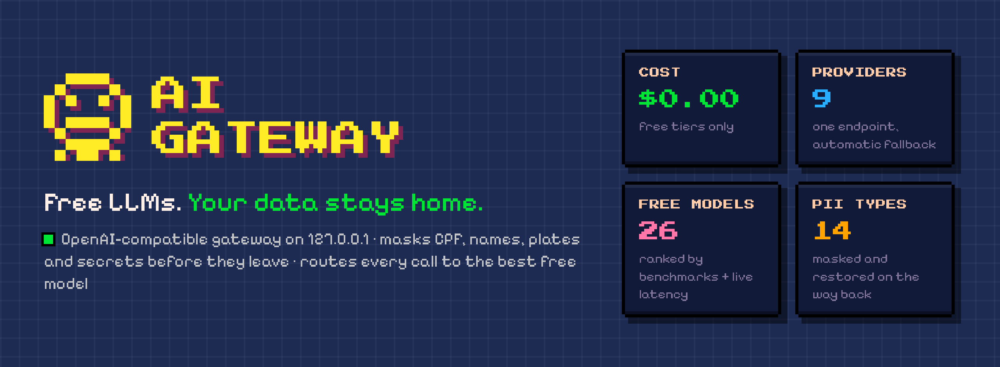
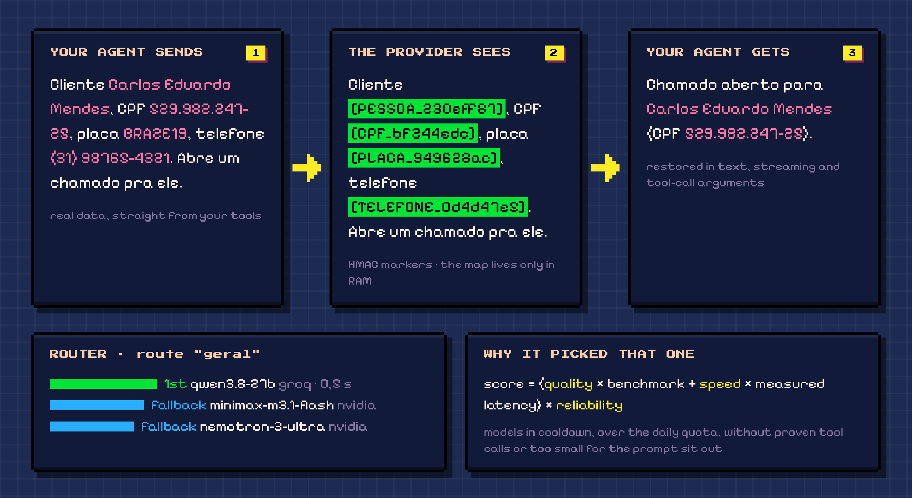
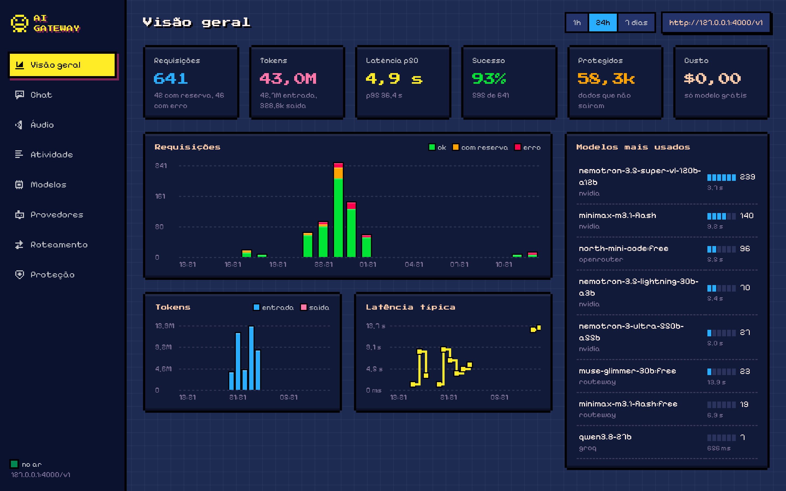

<p align="center"></p>

<p align="center">
  <a href="README.md">English</a> · <b>Português</b>
</p>

# ai-gateway

<p align="center"></p>

Gateway de IA local: um endereço só (`http://127.0.0.1:4000/v1`, Chat Completions da OpenAI) na frente de vários provedores gratuitos. **Os tipos de dado sensível detectados (tabela abaixo) não saem da máquina**, seja qual for o termo de uso do provedor.

```
agente (Hermes, script, qualquer cliente OpenAI)  ──►  ai-gateway (LiteLLM + proteção)  ──►  Routeway / NVIDIA / OpenRouter / Groq / Cerebras
                                      │ mascara CPF, nome, placa, segredo…
                                      │ escolhe provedor, faz fallback, respeita limite grátis
                                      │ devolve a resposta com os valores reais
                                      └ log de cada chamada, sem conteúdo
```

## Começar

```bash
git clone https://github.com/headdira/ai-gateway && cd ai-gateway
python3.12 -m venv .venv && .venv/bin/pip install -r requirements.txt
.venv/bin/python -m spacy download pt_core_news_md
./criar_env.sh                       # gera .env com as chaves internas
# cole as chaves dos provedores no .env (links abaixo)
.venv/bin/python testar_provedores.py   # confere chave e IDs de modelo (não gasta geração)
./subir.sh                           # sobe em 127.0.0.1:4000
.venv/bin/python testar_provedores.py --sondar # 1 chamada por modelo: latência real + tool call
# painel: http://127.0.0.1:4000/painel
.venv/bin/python relatorio.py        # uso, erros, latência e o que foi mascarado
./parar.sh                           # para pelo PID que o subir.sh gravou
```

Provedores grátis (pesquisa de novembro de 2026: só plano grátis usável no dia a dia, nada de trial que expira):

| Provedor | Chave | O que dá de graça | Situação aqui |
|---|---|---|---|
| **Kilo Gateway** | **não precisa** (chave opcional aumenta o limite) | Nemotron 3 Ultra 550B, Reflection Beam, Nemotron 3.5 Lightning / Super VL, todos com 1M de contexto · 200 pedidos/hora por IP | ✅ tool call provada |
| Groq | https://console.groq.com/keys | Qwen 3.8 27B, gpt-oss-120b · ~1.000 pedidos/dia por modelo | ✅ provado |
| NVIDIA NIM | https://build.nvidia.com/settings/api-keys | DeepSeek V4.1, GLM 5.3, MiniMax M3.1, Nemotron, Gemma 4 · ~40/min | ✅ provado |
| Routeway | https://routeway.ai/dashboard/keys | DeepSeek V4.1 Flash, MiniMax M3.1, Muse Glimmer · 200/dia | ✅ provado |
| OpenRouter | https://openrouter.ai/settings/keys | modelos `:free` · 50/dia (1.000/dia depois de comprar US$10 uma vez) | ✅ provado |
| Google AI Studio | https://aistudio.google.com/apikey | Gemini 3.8 Flash (maior nota do pool), Gemma 4 31B · limite só no console | configurado, falta chave |
| Z.ai | https://z.ai/manage-apikey/apikey-list | GLM-4.7-Flash, grátis por token | configurado, falta chave |
| Cloudflare Workers AI | token + account id | GLM-4.7-Flash, gpt-oss-120b · 10 mil neurons/dia | configurado, falta chave |
| Hetzner Inference | https://experiments.hetzner.com/inference | Qwen 3.8 27B, Qwen 3.6 35B · experimental, 10/min | configurado, falta chave |

A Cerebras continua funcionando se você tiver chave, mas deixou de ser grátis (virou trial com cartão). Depois de colar uma chave: `testar_provedores.py --sondar --provedor <nome>` faz 1 chamada por modelo e prova a tool call.

Provedor sem chave no `.env` fica fora da config, sem erro.

## Painel

<p align="center"></p>

**http://127.0.0.1:4000/painel**: ranking ao vivo de cada rota (por que cada modelo está onde está), últimas decisões (escolhido → quem atendeu, tentativas, latência, dado protegido), uso por provedor contra a cota grátis e números do dia. Atualiza a cada 4 s. Não mostra conteúdo de mensagem nem chave.

## Chat com agente (`gw/harness.py`)

No painel, a aba **Chat** conversa com o **Hermes** (Nous Research), um agente completo. Ele usa este gateway como modelo, na rota `geral`: passa pela máscara, pelo roteamento e aparece em Atividade como `hermes-chat`.

- **Instalação:** clone e instale o [hermes-agent](https://github.com/NousResearch/hermes-agent) (`uv sync`) e aponte `GW_HERMES_DIR` no `.env` para a pasta dele.
- **Processo:** sobe numa porta livre, em sessão própria; o PID fica em `logs/harness-hermes.pid` e o `parar.sh` derruba junto.
- **Perfil isolado** em `harness/hermes-home` (gerado a cada subida, fora do git), API de Runs e `approvals.mode: manual`. Todo comando perigoso pede aprovação no chat; o padrão dele é `smart`, em que outro LLM decide sozinho.
- **Aprovação:** cartões de aprovar/negar e de pergunta aparecem na conversa. Sem resposta em 10 minutos, a ação é negada.
- **Segurança:** as ações do chat (`POST /painel/chat/*`) só aceitam JSON com o header `X-GW-Painel`, vindo do próprio host do gateway. Outro site aberto no navegador não consegue disparar o agente (testado no e2e).
- **Tamanho do prompt:** o Hermes manda de 2,5 a 12 mil tokens por chamada. Modelo de contexto curto (Routeway `:free`, 42K) fica perto do limite.

## Roteamento inteligente (`gw/roteador.py`)

O agente pede uma **rota** no campo `model`. A cada pedido, o gateway ordena os modelos daquela rota e manda: o 1º vira o modelo, e os 3 seguintes, o fallback daquele pedido.

```
pontuação = (peso_q × qualidade + peso_v × velocidade) × confiabilidade
```

- **Qualidade (0-100):** nota a partir dos benchmarks públicos do catálogo Routeway (HLE, SciCode, LCR, GPQA, τ², IFBench, Terminal-Bench 2.1), normalizada dentro do pool (`atualizar_qualidade.py` → `qualidade.json`). Modelo fora do catálogo usa a `nota` manual do `modelos.yaml`. No painel, passe o mouse na nota para ver os benchmarks.
- **Velocidade:** latência real medida (média móvel). Sem medida, palpite do catálogo.
- **Confiabilidade:** (sucesso+2)/(sucesso+falha+2,5) com esquecimento. Começa em 80%, otimista, para o roteador experimentar os de nota alta.
- **Fica de fora:**
  - modelo **em espera** depois de erro: 429 por 10 min, timeout por 5 min, chave ou permissão por 1 h, outro por 2 min; o tempo dobra a cada erro seguido;
  - modelo com a **cota do dia** esgotada;
  - modelo **sem visão**, se o pedido tem imagem;
  - modelo cuja **ferramenta falhou**, se o pedido usa ferramenta. Ferramenta não provada perde 40% da pontuação;
  - modelo com **contexto menor** que o prompt.
- **Quem atendeu de verdade** vem da resposta (`model_id`). Quem estava antes na fila e não atendeu é marcado como falha. A espera é do gateway, não do LiteLLM, porque a do LiteLLM não disparou nos testes.
- **Reserva:** se a rota não completa a fila, entram os melhores da `geral`. Exemplo: com os DeepSeek em espera, a rota `deepseek` é atendida pelo melhor disponível em vez de devolver 502.

| Rota | Perfil (qualidade/velocidade) | Modelos |
|---|---|---|
| `geral` | equilibrado 60/40 | todo o pool |
| `rapido` | velocidade 25/75 | todo o pool |
| `deepseek` | qualidade 85/15 | DeepSeek V4.1 (Routeway, NVIDIA) → reserva `geral` |
| `contexto-longo` | qualidade 85/15 | contexto ≥ 250 mil tokens → reserva `geral` |
| `visao` | qualidade 85/15 | modelos com visão (imagem exige `GW_IMAGENS=permitir`) |
| `local` | qualidade | modelo local já rodando (`GW_LOCAL_URL`) |

Pedir um modelo direto também funciona (`"model": "m:groq/qwen/qwen3.8-27b"`), sem escolha, só com a proteção.

**Sondagem:** `testar_provedores.py --sondar` chama cada modelo uma vez pedindo uma tool call. Ela mede a latência real e prova a ferramenta. Rode quando adicionar modelo ou quando quiser reavaliar todos; o roteador também aprende sozinho com o uso.

Para mudar o pool ou as rotas: edite `modelos.yaml` e rode `./parar.sh && ./subir.sh`. Para atualizar as notas: `.venv/bin/python atualizar_qualidade.py`.

## Usar nos agentes

**Hermes** (`~/.hermes/config.yaml`; usa Chat Completions, que é a rota aberta):
```yaml
model:
  provider: custom
  base_url: http://127.0.0.1:4000/v1
  api_key: <GW_MASTER_KEY>
  default: geral
```

**Qualquer cliente que fale Chat Completions:**
```python
from openai import OpenAI
c = OpenAI(base_url="http://127.0.0.1:4000/v1", api_key="<GW_MASTER_KEY>")
c.chat.completions.create(model="geral", user="meu-agente", messages=[{"role": "user", "content": "oi"}])
```
O campo `user` aparece no log como `agente`.

## Proteção de dados (`gw/`)

Toda string de conteúdo é varrida antes do roteamento: mensagens, resultado de ferramenta e argumentos de tool call. Por isso a proteção vale para qualquer provedor, retry e fallback.

| Tipo | Como detecta |
|---|---|
| CPF, CNPJ (numérico e alfanumérico), RENAVAM | formato + dígito verificador |
| CNH, RG | formato + palavra de contexto antes ("CNH", "RG") |
| Cartão | Luhn |
| Placa (antiga e Mercosul), chassi, telefone (DDD válido), e-mail, CEP, endereço de rua | regex |
| Segredo | regras embutidas (AWS, GitHub, OpenRouter, Vault…), bloco PEM, `Bearer`, `senha: …`; opcionalmente as regras de um `scan.py` externo (`GW_SECRET_GATE`) |
| Pessoa | NER em português (spaCy `pt_core_news_md`, CPU, ~3 ms/frase, sem LLM) |

- **Máscara reversível:** cada valor vira `[TIPO_xxxxxxxx]` (HMAC com `GW_CHAVE_MASCARA`). O mesmo CPF dá o mesmo marcador em todo turno, então a conversa fica coerente e o cache de prompt funciona. O mapa marcador → valor fica **só em memória**.
- **Na volta:** os marcadores viram o valor real no texto e nos argumentos de ferramenta, com ou sem streaming (marcador partido entre pedaços é remontado). O agente trabalha com o dado real; o provedor nunca viu.
- **Aviso no system:** quando algo é mascarado, o modelo recebe uma linha explicando os marcadores e pedindo para copiá-los exatamente.
- **Sem desligamento por requisição:** a proteção é callback, não guardrail, e o cliente não consegue desativá-la pelo metadata (testado).
- **Imagem, arquivo e áudio:** barrados por padrão, porque não são inspecionáveis aqui. `GW_IMAGENS=permitir` libera, por sua conta.
- **Bloquear em vez de mascarar:** `GW_BLOQUEAR=SEGREDO,CARTAO` devolve 400 quando esses tipos aparecem.
- **Falso positivo:** termos em `permitidos.txt` (e no seu `permitidos.local.txt`, fora do git) nunca são mascarados.

**Limites conhecidos:**
- O NER não pega todo nome (às vezes classifica pessoa como organização). O modelo `pt_core_news_lg` (~500 MB) é mais preciso: troque com `GW_NER_MODELO`.
- Dado sensível em formato livre que não é nenhum dos tipos acima (ex.: "o cliente tem diabetes") **não** é detectado.

## Governança e observabilidade

- Escuta só em `127.0.0.1`. Toda chamada exige `GW_MASTER_KEY`.
- **Rotas fechadas por padrão** (`gw/servidor.py`): só `POST /v1/chat/completions`, `GET /v1/models`, `GET /health/*` e o painel (`GET /painel`, `/painel/dados`) passam. Todo o resto responde 403 antes de chegar no LiteLLM: pass-through (`/openai/*`, `/gemini/*`, `/anthropic/*`), `/v1/responses`, `/v1/messages`, `/v1/embeddings` e admin (`/key/*`, `/ui`). Só abra uma rota depois de provar a máscara nela no e2e.
- **Ambiente limpo:** o `subir.sh` usa `env -i`, então chave de provedor exportada no seu shell não entra no processo. As chaves dos provedores também usam nomes próprios (`GW_*`).
- Sem `GW_CHAVE_MASCARA` o gateway não sobe (falha fechada).
- `logs/requisicoes.jsonl`: uma linha por chamada com rota, provedor, modelo, latência, tempo até o 1º token, tokens, status/erro, agente e contagem do que foi mascarado. **Sem conteúdo.** O LiteLLM roda com `turn_off_message_logging`.
- `relatorio.py` resume por rota/provedor: chamadas, erros, 429, p50/p95 e o total mascarado.

## Testes

```bash
.venv/bin/python -m pytest -q tests/test_dados_sensiveis.py   # detecção, ida e volta, streaming partido
.venv/bin/python tests/e2e_proxy.py                           # proxy real + provedor falso que grava o que recebe
```

O e2e não gasta chave nem roda modelo. Ele confere que o provedor não recebe nenhum dado sensível e que o agente recebe tudo de volta (texto e tool call, com e sem streaming). Confere também:
- que a proteção não desliga pela requisição;
- que o log sai sem conteúdo;
- que imagem é barrada;
- que as rotas fora da lista dão 403 mesmo com `OPENAI_API_KEY` no ambiente.

## Arquivos

```
gw/dados_sensiveis.py   detectores, cofre, máscara/desmáscara
gw/protecao.py          callback do LiteLLM (ida, volta, streaming, log)
gw/servidor.py          sobe o LiteLLM atrás do filtro de rotas + serve o painel
gw/roteador.py          escolha do modelo a cada pedido + saúde (logs/saude.json)
gw/catalogo.py          lê modelos.yaml (pool, rotas, provedores)
gw/painel.html          painel
atualizar_qualidade.py  benchmarks → qualidade.json
modelos.yaml            provedores, rotas, ordem, limites grátis
gerar_config.py         modelos.yaml + .env → config.gerado.yaml
subir.sh / parar.sh     sobe/para (127.0.0.1, PID em logs/proxy.pid)
testar_provedores.py    confere chaves e IDs; --chat testa cada rota
relatorio.py            observabilidade
permitidos.txt          termos que nunca são mascarados
```

## Janela de contexto para agentes

O `GET /v1/models` mostra cada rota com o `contexto_anunciado` do `modelos.yaml` (131 mil tokens na `geral`), e não com o maior modelo do pool. O agente (ex.: Hermes) resume a conversa ao chegar perto desse número, então ela continua cabendo nos modelos rápidos. Se mesmo assim nenhum modelo livre couber o pedido, o gateway responde 400 `context length exceeded` (`code: context_length_exceeded`) e o agente resume e tenta de novo.

## Licença

[PolyForm Noncommercial 1.0.0](LICENSE) (aviso de copyright em [NOTICE](NOTICE)). Pode usar, estudar, modificar e redistribuir para uso pessoal, pesquisa, ensino e organizações sem fins lucrativos. **Uso comercial não é permitido** (vender, oferecer como serviço pago ou usar para fins comerciais). Para uso comercial, fale com o autor. Não é uma licença open source no sentido da OSI: é código aberto para consulta, sem uso comercial.

Os provedores, o LiteLLM, o hermes-agent e os modelos têm licenças próprias.
